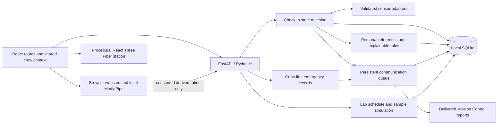

# ASTRA architecture

## One local product

The production FastAPI process serves the Vite build, MediaPipe model/WASM, API and background queue worker. SQLite is the sole database. Vite is only a development server; it proxies to the same API. No application path requires a hosted service after setup.



## Check-in orchestration

```text
IDENTIFYING → IDENTITY_CONFIRMED → FACIAL_SCAN → SENSOR_COLLECTION
→ VOC_SCAN → QUESTIONNAIRE → PROCESSING → RESULTS_READY → COMPLETED
```

Before `RESULTS_READY`, a check-in can be `CANCELLED`. Adapter failure returns a retryable error and leaves the state unchanged rather than persisting a misleading successful reading. Invalid/stale transitions return 409. Camera skipping is explicit. Unavailable physiological sensors can be explicitly skipped, and the result records missing data.

Every advance carries `expected_state`. The API acquires a SQLite writer lock before reading/updating the workflow, preventing simultaneous requests from both finalizing a check-in. Collection results stay in the check-in's draft JSON until processing. The processing transaction:

1. Compares the current data against historical references before inserting it.
2. Inserts readings, questionnaire response, VOC vector and optional facial observation.
3. Saves assessment observations and guidance.
4. Creates the outgoing health report and audit event.
5. Changes the state to `RESULTS_READY` and removes the temporary draft.

An exception rolls back all final records. Cancelling removes the draft without inserting sensor rows. The UI retains only the active check-in ID in session storage and retrieves the authoritative server state after refresh. Completed records cannot be cancelled or finalized a second time. A retry after an ambiguous network response can require refreshing to obtain the committed state.

3D modules derive their active state from this workflow. Orbital controls and equipment selection remain interactive. Rendering failure or missing WebGL does not remove the HTML workflow/equipment controls. Blood sampling has its own `PREPARED → SAMPLE_LOADED → ANALYZING → COMPLETED` sequence; it is not mandatory in every daily check-in.

## Schema

SQLAlchemy initializes version 1 using `create_all`, with foreign-key enforcement, WAL and a busy timeout. Startup checks the recorded schema version. Future incompatible schema changes require an explicit migration; this release does not silently rewrite existing tables. Initial seeding occurs once, and all seed writes are in one transaction.

- `astronauts`: profile, fiction flag, mission, schedule interval.
- `checkins`: workflow state, scenario, temporary draft and immutable assessment snapshot.
- `sensor_readings`: unique `(checkin_id, metric)`; units, source, time, quality, context, domain, simulation flag.
- `personal_baselines`: unique astronaut/metric/source, median, robust scale, count and establishment time.
- `facial_enrollments` / `facial_observations`: consent time, method, ratios, source and quality; no images or identity embeddings.
- `questionnaire_responses`: timestamped user-reported answers linked uniquely to a check-in.
- `voc_measurements`: six synthetic relative-response channels and collection conditions.
- `blood_tests`: workflow state and small structured result panel; no biological sample.
- `reminders`: last completed and next due time per astronaut.
- `health_observations` / `guidance_records`: saved reasoning and predefined follow-up content.
- `emergency_events`: event, crew-notification simulation, protocol and closed state.
- `communication_messages`: immutable report payload, current state and transition history.
- `settings`: link state, delay and schema version.
- `audit_events`: minimal entity/action trace, without raw sensor or facial data.

All dependent health records use cascading foreign keys. Some small one-to-one/structured data (assessment, lab panel, questionnaire, VOC channels) uses SQLite JSON columns rather than unnecessary join tables. No remote database or local JSON-file database is used.

## Sensor contract and provenance

`SensorAdapter` exposes connect, collect, validate and disconnect. Registered deterministic adapters cover wearable, vitals, thermal, inertial mass and cabin environment. Simulation output does not vary on dashboard rendering. Scenario-based deviations and manually adjustable values pass the same unit/domain/range/provenance validation as other inputs.

Future devices can submit `POST /api/checkins/{id}/readings` during `SENSOR_COLLECTION`, using the `ReadingInput` contract. This endpoint is real; no physical device implementation is included. Reading astronaut IDs must match, metric duplicates are rejected and timezone-aware timestamps are required. Synthetic source names use `simulated_`. Future real inputs cannot be compared to synthetic reference statistics.

The UI separates cabin conditions from body measurements. Questionnaire responses are user reports. Facial captures are `live_camera` or `synthetic_fixture`. VOC data is experimental and synthetic. Computed guidance states which inputs support it.

## Personal analysis

Seed references use 21 stable synthetic days for each astronaut. Reference center is the median, with scale `max(1.4826 × MAD, metric-specific floor)`. Absolute standardized departure ≥3 triggers an illustrative review/repeat flag. Recent slopes use up to seven same-context, same-provenance readings. Current findings do not update established references.

New profiles need seven normal-scenario check-ins with no reported fatigue/symptoms and well-being ≥6. Initial extreme outliers are excluded; at least five values per metric are required. A reference is then frozen. This is a demonstration enrollment policy, not clinical reference validation. Real-hardware reference enrollment remains future work.

A predefined multimodal rule combines higher pulse, shorter sleep and unusual reported fatigue. Additional rules use subjective concerns, facial comparison, VOC departures and >10% change in the last two simulated lab results. Lab changes enter analysis on the next daily check-in. No statistical rule activates or gates the emergency workflow.

VOC comparison uses the first 21 stored synthetic vectors (at least five required), per-channel median/MAD with a scale floor. Channel magnitudes are relative responses, not molecule concentrations. Interference explanations accompany deviations.

## Camera processing and privacy

Browser `getUserMedia` obtains video only, never microphone input. MediaPipe loads the installed model and WASM from local routes. It detects up to two faces so ambiguous multi-face captures are rejected. Up to ten sequential frames produce normalized eyelid opening, mouth tilt, eyebrow separation and asymmetry ratios. Light, estimated pose, face size and stability gates must pass before capture can be saved.

Explicit consent is required. Derived features are sent to the API; frames and raw landmark meshes are discarded in the browser. Track shutdown occurs on stop, unmount, capture and cancellation; asynchronous camera/model startup uses a generation token to dispose late results. Identity is always manually confirmed.

Comparison requires three prior valid observations from the same source and freezes those first three as the reference. Synthetic fixtures are isolated from live observations. Quality checks are engineering heuristics; they do not standardize all camera optics or clinically validate geometry. No edema, stroke, intracranial-pressure or retinal conclusions are drawn.

## Communications and roles

A report records `CREATED → QUEUED → IN_TRANSIT → DELIVERED → ACKNOWLEDGED`. A background worker processes the queue once per second using a separate thread, and reads also advance eligible transitions. A configured delay is measured from transit start. Link loss requeues in-flight reports and clears the transit start; restoration restarts the delay. Records and transition history survive restart. Acknowledgment is manual and allowed only after delivery.

`/api/mission-control` returns only delivered/acknowledged payloads. The separate onboard transport view shows queued metadata. Ground-role endpoints require the demo `X-Astra-Role` header. The selector/header is an explicit local demonstration boundary, not authentication. It does not protect data from someone with local/API access.

## Operational limits

The single production process must be running for UI, analysis and reminders. This is offline-first local hosting, not a service-worker app that runs after the local service stops. Reminders are recomputed on read/reopen; no OS push is scheduled. The browser suite is supplied but execution and visual QA were blocked by the browser permission gate in this session. Physical camera behavior remains to be validated on target hardware.
